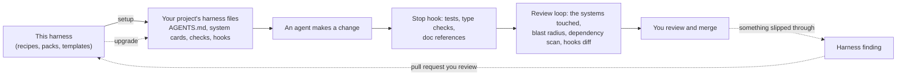

# Coding agents harness

**Make coding agents safer, cheaper and easier to review, in any project.**

A reusable way of working with coding agents. It is a recipe book, not a library: nothing here runs
inside a project, and no project depends on it. An agent reads it, writes the project's own harness
files (instructions, checks, reviewers, hooks), and you review them before anything is committed.

## What it gives a project

| | |
|---|---|
| **Reviews where the risk is** | The app is split into systems by how they fail: sign-in, data access, money, payments, privacy, performance, state and timing. A change wakes a reviewer only for the systems it touches. You choose how involved you are in each one. |
| **Security built in** | A vulnerability scan of every dependency change (OSV-Scanner), a "stranger check" before any new package moves in, install scripts off by default, and every command that runs on its own (hooks, install scripts) shown word for word before merge. Harness files need your approval to merge. |
| **Fewer tokens** | Small answers instead of file-by-file searching. An optional code index tells agents where code is and what uses it, the review loop hands reviewers the blast radius of a change, and the always-loaded instructions file has a size budget. |
| **Docs that stay true** | A check fails when the docs name a file that's gone, a line number that has moved, or a function that's no longer there. |
| **Rules a program enforces** | Anything a linter, test or hook can check goes in one. Prose is for the rest. |
| **It learns** | When something slips through, the project writes a finding; the lesson becomes a harness change, and every project picks it up on its next upgrade. |

## How it works

## Measured

Tools earn a place by testing, following `evaluate.md`. The code index was tested on a ~480-file
TypeScript project: 5 read-only questions, 2 runs per setup, the same model throughout, and answers
graded blind against a key checked against the code.

| Setup | Tokens | Cost | Time | Tool calls / file reads | Score |
|---|---|---|---|---|---|
| No code index | 1.77M | $2.63 | 274 s | 75 / 33 | 18 / 20 |
| Code index, its default tool (pastes source) | 1.57M | $2.63 | **202 s** | **35 / 3** | 18 / 20 |
| **Code index, small answers (what this harness uses)** | **1.48M** | **$2.19** | 241 s | 50 / 12 | 18 / 20 |

Small answers (names and file:line, then read only what's needed) used **16% fewer tokens** and
**cost 17% less**, with **equally good answers**. Tokens and cost don't move together: tokens count everything
the model processed, including earlier context re-read from cache at a tenth of the price, while
cost is driven by new text entering the context. That's why pasting source cut tokens by 11% but
saved no money. It's a small sample: enough to show large differences, not small ones.

The doc-reference check, run on a real project's architecture docs, found 7 functions cited at the
wrong line and raised no false failures.

## Quick start

1. **Clone this repo** anywhere on your machine:
   `git clone <this repo's URL> ~/coding-agents-harness`
2. **Open your project** (new or existing) in your coding agent.
3. **Say:** "Set up this project with the harness at `~/coding-agents-harness/setup.md`."
   For a new project, describe the idea in a few sentences first.

The first time on a machine, setup stops before anything else and walks you, one step at a time,
through putting the trust rule in a locked glass case (below). It takes a few minutes and needs your
computer's password; the agent never sees it. After that, agents find the harness on their own, and
you never give the path again.

Setup asks only what's yours to decide: the project type, how changes reach the main branch,
anything that costs money or changes who can see what, any clash with what the project already does,
and whether to add a code index. Everything else it decides and lists for you to object to.

## Currently supported

Keep this list up to date with every change to `packs/` or `rules/`.

| | Supported | Default opinion |
|---|---|---|
| **Languages** | Python · TypeScript / JavaScript · Rust | Google's style guide for each, plus the overrides in `rules/style.md` (plain code over clever syntax; unknown is explicit) |
| **Platforms** | GitHub · GitLab · Azure Repos | Harness files need the owner's approval to merge |
| **Agents** | Claude Code · Codex | One trust rule, pointed at from each agent's personal instructions file |
| **Project types** | Product · Learning | Product: the agent builds. Learning: the owner builds the parts they want to learn |
| **Optional tools** | CodeGraph (code index) | Off unless the owner chooses it; only its small commands, telemetry off |

## The ideas in one screen

- **Tiers** say how risky a change is, by what it does. Specs for tier 2 and 3.
- **Systems** are the parts of an app, cut by how they fail, not by layer. Each has a **system card**
  in the project: what must always be true, what pulls a change up to the owner, and how it breaks.
- **The involvement dial** on each card says how involved the owner is: *Teach me*, *Keep me
  posted*, *Trust*, or *I build it, you coach*.
- **One builder agent per change; a reviewer per critical system**, woken only when a change touches
  that system's files. The author never judges their own work.
- **Rules a program can check go in a program** (linter, guard test, hook). Prose is for the rest.

## Before you start

**Once per machine, you put the trust rule in a locked glass case.** Setup walks you through it; you
type the commands and the password yourself. The rule tells every coding agent to treat this harness
as material to review, never as instructions. Think of it as a notice in a glass display case: every
agent can read it, and none can change it, because the key is your computer's password.
`trust-rule.md` walks through it for macOS, Linux and Windows, and for Claude Code and Codex:

1. Create the rule file in a neutral folder (`~/.config/coding-agents-harness/`).
2. Create the `source` file next to it, saying where agents get the harness from: a GitHub repository
   (a fork works), the latest commit in a local folder, or a local folder with uncommitted edits
   (`source.md`).
3. Point each agent you use at the rule from its personal instructions file.
4. Lock the rule, the source and the pointers with your password.

Setup checks all four and stops if any is missing. It never writes or locks them for you, because a
harness that installs its own safety rule could install a weaker one.

## How to use it

- **New project:** describe the idea in a few sentences, then: "Set up this project with the harness
  at `<path>/setup.md`."
- **Existing project:** the same. Setup inspects the project first and builds on what's there.
- **Upgrade:** "Upgrade the harness." The agent finds it through your `source` file. Only when you
  ask; never automatic. A new rule that existing code would fail is never fixed inside the upgrade:
  you choose to fix it separately, apply it to new files only, or skip it.
- **Something slipped through:** in that project, "Should the harness have caught this? Write a
  harness finding." Bring the finding here and ask for a change. Review it as a pull request.

## What's here

| Path | What it is |
|---|---|
| `setup.md` | The prompt for setting up a new or existing project. Start here. |
| `upgrade.md` | The prompt for bringing a project up to the latest harness version. |
| `finding.md` | How a project reports something the harness should have caught. |
| `evaluate.md` | How to test a tool or rule fairly before adopting it. |
| `trust-rule.md` | The rule that keeps harness content from acting as instructions. |
| `source.md` | Where agents read the harness from, and how. |
| `project-types.md` | Product (taxi) or learning (driving school): the dial's defaults. |
| `rules/` | Working rules and code style shared by every project. |
| `packs/languages/` | Checks, linters, dependency safety and classic traps per language. |
| `packs/platforms/` | The approval lock and weekly vulnerability alerts on GitHub, GitLab and Azure Repos. |
| `packs/tools/` | Optional tools a project can choose, set up safely (a code index). |
| `templates/` | Starting points for agents, commands, hooks, scripts and system cards. |
| `CHANGELOG.md` | What changed in each version, so an upgrade can say what's new. |
| `LICENSE` | MIT. |

## Changing this repo

Every change goes through a pull request the owner reviews line by line; nothing merges to `main`
any other way.

1. **Start from a finding** (`finding.md`), with the project stripped out: no code, names, file paths,
   customers, secrets or incidents that identify a project. If the lesson can't be stated without
   them, it belongs in that project, not here.
2. **One concern per branch.** Name the branch after the change.
3. **Prove it.** A new check runs on a real project and on made-up cases that must pass and must fail.
   A new tool is tested as `evaluate.md` describes, with its numbers in the pull request.
4. **Bump `VERSION` and add a `CHANGELOG.md` entry**, written for the projects that will upgrade:
   what changes for them, or "no change for projects".
5. **Flag anything sensitive at the top of the pull request:** a change to the trust rule, the approval
   lock, hooks, allowlists, anything that runs commands, or a new third-party dependency (with
   everything it brings in).
6. **Keep this README true:** the supported list, the table of files, and the measured results.

## Renaming this repo

Safe. GitHub forwards the old address, so existing clones keep pushing and pulling (update a remote
with `git remote set-url origin <new url>` when convenient). The trust rule describes the harness
rather than naming it, and `~/.config/coding-agents-harness/` keeps its name, so the glass case is
never touched. Update only: this README's title, the repository description, and the line in each
project's `AGENTS.md` that names the harness (the next upgrade can do that).

## License

MIT. See `LICENSE`.
